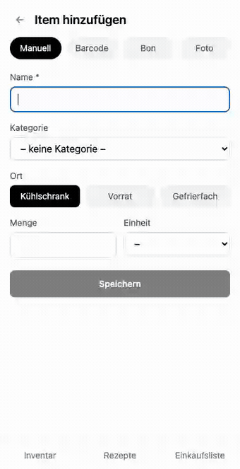
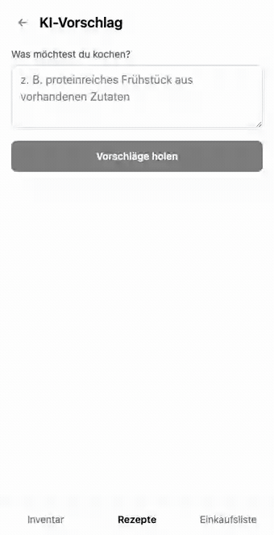
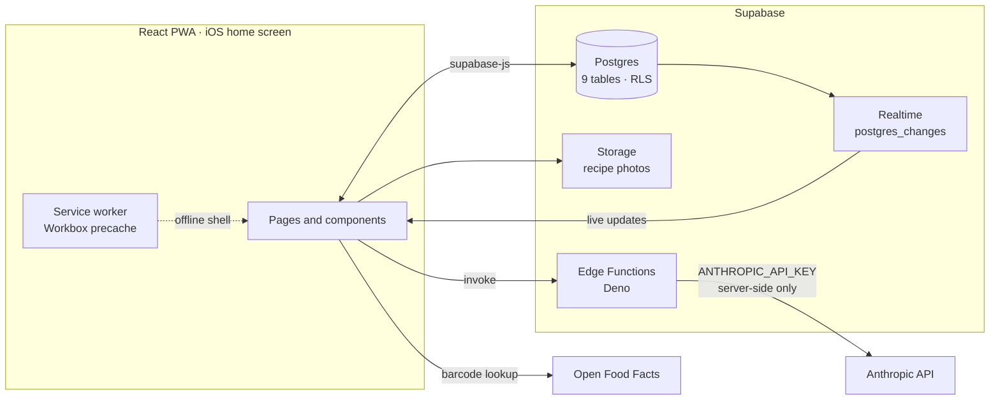

# What's in my Fridge?

**Most "AI apps" are a chat box. This one is a pantry that reads your receipts.**

A household inventory PWA that keeps track of what food is actually in the house,
matches it against your recipes, and answers the question you actually have at
18:30 on a Tuesday: *what can I cook right now, without going shopping?*

Point your camera at a supermarket receipt — or at the open fridge — and the
contents land in the database as structured, unit-aware inventory. Open the app
and it tells you which recipes you can cook tonight, and exactly which ingredient
is missing from the ones you can't.

Built for my own household, and installed on our phones. Not a tutorial project.

<p>
  
  
  
  
  
  
</p>

> The interface is in German, because the people who use it every day are. The
> code, comments and docs are in English.

---

## The 60-second version

| | |
|---|---|
| **The problem** | Food gets bought twice and thrown away once, because nobody knows what's in the freezer. |
| **The hard part** | Not the CRUD. It's deciding whether "1 Dose" of tomatoes covers a recipe asking for "400 g" — and whether "Milch" in the fridge satisfies a recipe wanting "Kokosmilch". (It doesn't.) |
| **The AI part** | 9 Claude-backed Edge Functions doing vision parsing, classification and structured extraction — never a chat box, always a typed result that flows into the database. |
| **The scale** | ~5,500 lines of TypeScript frontend, ~1,000 lines of Edge Functions, 21 SQL migrations. Small, but finished. |
| **The proof** | It runs on the household's phones over a private tailnet, syncing live between them — not a screenshot of a prototype. |

---

## Feature tour

### Add an item — four ways in

Type it and the category and storage location are suggested as you type. Or scan
a barcode. Or photograph the receipt. Or just photograph the inside of the fridge
and let the model enumerate what it sees. Everything lands as editable rows you
confirm before saving.



### Ask for a recipe you can actually make

Free text in ("high-protein breakfast", "something with chickpeas"), and the model
proposes recipes constrained to what's genuinely in stock — savable as real
recipes in one tap.



<details>
<summary><b>The rest of the app</b> — inventory, recipes, meal plan, shopping list</summary>

### Inventory

Everything in the house across fridge, pantry and freezer, grouped by category,
with search and filters. At the top: what you could cook right now, matched to
the current time of day.


### Recipes

A traffic-light readout of how many ingredients you have for each recipe. Change
the portion count and quantities *and prose instructions* are recalculated live.


### Meal plan

Spread recipes across the coming week, adjust portions per day, and push every
missing ingredient for the whole week onto the shopping list in one action.


### Shopping list

Bought items move straight into the inventory, with storage location and category
suggested automatically.


</details>

---

## What this project demonstrates

| Capability | How it shows up here | Where to look |
|---|---|---|
| **LLM product engineering** | 9 task-specific Edge Functions: vision parsing of receipts, fridge photos and recipe screenshots; item classification; tag inference; recipe scaling; nutrition estimation; constrained recipe generation | [`supabase/functions/`](supabase/functions/) |
| **LLM failure-mode handling** | Strips markdown fences the model adds unasked; finds the `text` block instead of assuming `content[0]`; every response is parsed into a typed shape before it reaches the UI | [`_shared/extractJson.ts`](supabase/functions/_shared/extractJson.ts), [`_shared/anthropic.ts`](supabase/functions/_shared/anthropic.ts) |
| **Secrets discipline** | The Anthropic key lives as a Supabase secret and is only ever touched server-side. The client cannot reach the model directly, by construction | [`supabase/functions/`](supabase/functions/), `.env.example` |
| **Domain modelling** | Unit algebra that pivots through grams so container units ("Dose", "Packung") can be compared with weights — and refuses to guess when the answer is genuinely unknowable | [`src/lib/stock.ts`](src/lib/stock.ts) |
| **Schema ownership** | 21 forward migrations, including renames, column drops and a realtime publication — the schema was evolved, not designed once and frozen | [`supabase/migrations/`](supabase/migrations/) |
| **Realtime collaboration** | Two phones in the same household stay in sync: consume something on one and it disappears on the other, without a refresh | [`src/lib/useRealtimeRefresh.ts`](src/lib/useRealtimeRefresh.ts) |
| **Optimistic UI with real undo** | Destructive actions apply instantly and are reversible — including restoring a recipe's ingredient rows after a cascade delete | [`src/lib/ToastContext.tsx`](src/lib/ToastContext.tsx), [`src/pages/Recipes.tsx`](src/pages/Recipes.tsx) |
| **Offline-capable PWA** | Installs to the iOS home screen, precached with Workbox, with data calls deliberately excluded from caching | [`src/sw.ts`](src/sw.ts), [`vite.config.ts`](vite.config.ts) |
| **Design system thinking** | A small token system — three type roles, a cold-chain colour ramp, one signature component — instead of ad-hoc utility classes per page | [`src/index.css`](src/index.css), [`src/components/AvailabilityMeter.tsx`](src/components/AvailabilityMeter.tsx) |

---

## Four decisions worth reading the code for

### 1. "Milch" must not match "Kokosmilch"

German fuses compound words. A naive `includes()` check happily reports that you
have coconut milk because there's milk in the fridge — a wrong answer that
silently corrupts every recipe availability count in the app.

Matching is therefore done on word boundaries, with a light singularisation pass
so "Tomaten" still matches "Tomate". Small function, unglamorous, and the whole
feature set is worthless without it.

→ [`src/lib/matching.ts`](src/lib/matching.ts)

### 2. Comparing a tin to a weight

A recipe wants `400 g` of tomatoes. The pantry has `1 Dose`. Are you covered?

There's no universal answer — a tin of tomatoes and a tin of coconut milk don't
weigh the same — so items can optionally record their own grams-per-unit factor,
and grams becomes the pivot unit for comparison. When neither side can be
converted, the code returns `null` and the caller falls back to a presence check
rather than inventing a number.

Knowing when *not* to compute an answer was the actual design work here.

→ [`src/lib/stock.ts`](src/lib/stock.ts)

### 3. Scaling a recipe must not damage the recipe

Cooking for four when the recipe serves two rescales the ingredient quantities —
and sends the prose instructions to the model to be rewritten, so "beat 2 eggs"
becomes "beat 4 eggs".

That rewrite is strictly a view-level transformation. It always scales from the
original instructions rather than a previously scaled version, and is never
written back. A model rewriting your saved recipes in place, compounding drift
each time, is a data-loss bug waiting to happen.

→ [`src/pages/RecipeDetail.tsx`](src/pages/RecipeDetail.tsx)

### 4. An auth decision, stated plainly

There is no login, and the row-level security policies are open. That is a
deliberate trade, not an oversight: the app is never exposed to the public
internet. It's served over [Tailscale](https://tailscale.com/kb/1242/tailscale-serve)
to a private tailnet, so the network *is* the access boundary, and household
members share one dataset by design.

It's the right call for this deployment and the wrong call for a public one. If
this ever needed multi-tenancy, the change is scoped: per-user policies on the
existing tables, and an auth gate in front of the router.

→ [`supabase/migrations/0001_init.sql`](supabase/migrations/0001_init.sql)

---

## Architecture



The client never holds a model API key. Every LLM call is a typed request to a
task-specific Edge Function, which owns the prompt, the key, and the job of
turning a language model's output back into a validated object.

**The nine Edge Functions:** `parse-receipt` · `parse-fridge-photo` ·
`parse-recipe-screenshot` · `classify-item` · `classify-items` ·
`guess-recipe-tags` · `scale-recipe` · `estimate-nutrition` · `suggest-recipes`

---

## Stack

| Layer | Choice |
|---|---|
| Frontend | React 19, TypeScript, Vite 8, React Router 7 |
| Styling | Tailwind CSS 4 with a custom token layer |
| Backend | Supabase — Postgres, Realtime, Storage, Edge Functions (Deno) |
| AI | Anthropic API, proxied server-side |
| PWA | `vite-plugin-pwa` with an `injectManifest` Workbox service worker |
| Extras | `html5-qrcode` for barcodes, Open Food Facts for product data, `heic2any` for iPhone photos |

---

## Run it yourself

```bash
npm install
cp .env.example .env    # add VITE_SUPABASE_URL and VITE_SUPABASE_ANON_KEY
npm run dev             # http://localhost:5173
```

You'll need a Supabase project for anything beyond the shell.

<details>
<summary><b>Full setup</b> — database, Edge Functions, demo data, installing on an iPhone</summary>

### 1. Create a Supabase project

Create a project at [supabase.com](https://supabase.com), install the
[Supabase CLI](https://supabase.com/docs/guides/cli), then link this repo to it:

```bash
supabase login
supabase link --project-ref <your-project-ref>
```

### 2. Push the schema

```bash
supabase db push
```

This creates `food_items`, `recipes`, `recipe_ingredients`, `shopping_list_items`,
`meal_plan_items`, `recipe_cook_log`, `staple_items`, `consumption_log` and
`inventory_log`. See [`supabase/migrations/`](supabase/migrations/).

### 3. Deploy the Edge Functions

```bash
supabase functions deploy suggest-recipes
supabase functions deploy classify-item
supabase functions deploy classify-items
supabase functions deploy guess-recipe-tags
supabase functions deploy scale-recipe
supabase functions deploy parse-receipt
supabase functions deploy parse-recipe-screenshot
supabase functions deploy parse-fridge-photo
supabase functions deploy estimate-nutrition

supabase secrets set ANTHROPIC_API_KEY=your-anthropic-api-key
```

The model key is set as a Supabase secret, **not** in `.env` — it must never
reach the client.

### 4. Environment variables

```bash
cp .env.example .env
```

Fill in `VITE_SUPABASE_URL` and `VITE_SUPABASE_ANON_KEY` from Project Settings →
API.

### 5. Demo data

To try the app with a populated pantry, recipes, a shopping list, a week's meal
plan and 30 days of history for the statistics:

```bash
node scripts/seed-demo-data.mjs
```

### 6. Install on an iPhone

The app must be served over **HTTPS** to install as a PWA. Since this is a
household app, that runs over Tailscale rather than a public deployment — Mac and
iPhone both need to be on the same tailnet.

Set `VITE_ALLOWED_HOST` in `.env` to your machine's Tailscale hostname (e.g.
`your-machine.your-tailnet.ts.net`) so Vite accepts requests with that Host
header, then:

```bash
npm run preview -- --port 4173 --strictPort --host 127.0.0.1
```

Configure [`tailscale serve`](https://tailscale.com/kb/1242/tailscale-serve) to
proxy port 4173 once; the configuration persists. The app is then reachable at
`https://your-machine.your-tailnet.ts.net/`.

On the iPhone, open that URL in **Safari** → Share → **"Add to Home Screen"**. It
launches fullscreen with its own icon. No App Store account, no review, no annual
fee, and nothing publicly reachable on the internet.

### 7. Adding household members

Invite their devices to the same tailnet (Tailscale admin console → *Invite
users/devices*). No in-app login is needed, because all devices on the tailnet
share one dataset — see [decision 4](#4-an-auth-decision-stated-plainly).

Every shared table is attached to the Supabase realtime publication
([`0009_enable_realtime.sql`](supabase/migrations/0009_enable_realtime.sql)) and
the pages subscribe to `postgres_changes`
([`useRealtimeRefresh.ts`](src/lib/useRealtimeRefresh.ts)), so open tabs stay in
sync without a manual reload.

</details>

---

## Project structure

```
src/
  components/   # shared UI, incl. the availability meter and bottom nav
  pages/        # routes: inventory, recipes, meal plan, shopping list, stats
  lib/          # Supabase client, unit algebra, matching, realtime, toasts
  types/        # shared TypeScript types
  index.css     # design tokens and component classes
supabase/
  migrations/   # 21 forward SQL migrations
  functions/    # 9 Edge Functions — the LLM layer
scripts/
  seed-demo-data.mjs       # populate the DB with a realistic dataset
  backfill-nutrition.mjs   # estimate nutrition for older recipes
```

---

## License

MIT — see [LICENSE](LICENSE).
